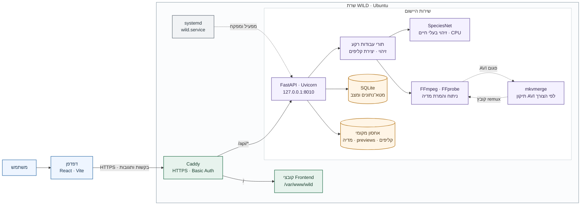

# עדכוני ארכיטקטורה להעלאת WILD לשרת ענן (Hostinger KVM 4)

תאריך התוכנית: 5 בנובמבר 2026 | עדכון סטטוס: 6 בנובמבר 2026. המסמך מתייחס ליישום WILD הנוכחי במאגר (FastAPI + React/Vite), ולא ליישום אחר.

## 1. מטרה והחלטות

| נושא | החלטה |
|---|---|
| מטרה | ניסוי של כחודש, 3–5 משתמשים שבוחנים את היישום |
| שרת | Hostinger VPS **KVM 4**: 4 vCPU, 16GB RAM, 200GB NVMe, Ubuntu 24.04, חיוב חודשי |
| מבנה | מכונה אחת: Reverse proxy ← Backend (FastAPI) ← SQLite + קבצים מקומיים |
| GPU | לא נדרש. זיהוי ורינדור רצים על CPU |
| מה לא עושים בניסוי | PostgreSQL, S3, Redis/RQ, Docker Swarm/Kubernetes, מספר שרתים |
| מחיר | $25.99 לחודש הראשון, חידוש $42.99 לחודש (לפי העגלה). גיבוי יומי אופציונלי: $12 לחודש |

**המחיר של KVM 4 בא על חשבון ביצועים.** במדידה המקומית (Ryzen 7 7840HS, 16 ליבות לוגיות) זיהוי SpeciesNet על סרטון בן 10 שניות ניצל בממוצע כ־7.8 ליבות וארך כ־17.7 שניות בריצה חמה, עם שיא זיכרון של כ־1.6GB לתהליך. על 4 vCPU משותפים של VPS יש לצפות לזמני זיהוי ארוכים יותר (לפחות פי 2, הערכה בלבד — יש למדוד). זיכרון 16GB מספיק בנוחות; ה־CPU הוא צוואר הבקבוק.

למה לא לשנות את הארכיטקטורה לענן "מלא": עם מופע אחד ו־3–5 משתמשים, SQLite ואחסון מקומי מספיקים, והמעבר ל־PostgreSQL/S3 (שלב 8 ב־[IMPLEMENTATION_PLAN.md](./IMPLEMENTATION_PLAN.md)) יוסיף עבודה בלי תועלת בניסוי. את המעבר מומלץ לבצע רק אם הניסוי מצליח.

## 2. ארכיטקטורה פעילה



### הרכיבים העיקריים

| רכיב | תפקיד ביישום | היכן הוא פועל/נמצא |
|---|---|---|
| **Frontend — React ו־Vite** | הממשק בדפדפן: ספריית המדיה, תצוגה מקדימה, זיהויים, ציר זמן והגדרות יצירת קליפים. בפריסה הוא מוגש כקבצים סטטיים. | נבנה בתיקיית `frontend/`; קובצי הפריסה נמצאים ב־`/var/www/wild` |
| **Caddy** | נקודת הכניסה מהאינטרנט: HTTPS ותעודה, Basic Auth, הגשת הפרונט והעברת `/api/*` ל־Backend. | חשוף בפורטים 80/443 |
| **Backend — FastAPI על Uvicorn** | ה־API לניהול פרויקטים ומדיה, העלאות, זיהוי, תוצאות ועבודות יצירת קליפים. שולח עדכוני התקדמות זיהוי דרך SSE. | שירות `wild.service` ב־`127.0.0.1:8010`; רץ כמשתמש `wild` ובתהליך יחיד |
| **SQLite** | שומר מטא־נתונים ומצב: פרויקטים, פריטי מדיה, זיהויים וקליפים. תוכן קובצי המדיה עצמם אינו נשמר בתוך מסד הנתונים. | `/var/lib/wild/wild.db` |
| **אחסון קבצים מקומי** | שומר קובצי מקור, תמונות ממוזערות, previews ותוצרי קליפים. | תחת `/var/lib/wild/projects/` |
| **תורי עבודות רקע** | מריצים זיהוי ויצירת קליפים בנפרד מבקשת המשתמש; כל סוג עבודה משתמש כרגע ב־worker יחיד ובתור בזיכרון. | בתוך תהליך ה־Backend; המשימות אינן מנוהלות על ידי תור חיצוני |
| **SpeciesNet** | מנתח תמונות ופריימים מסרטונים ומפיק זיהויי בעלי חיים. | ספריית Python ומודל שרצים על CPU בשרת |
| **FFmpeg / FFprobe** | קוראים וממירים וידאו, מפיקים thumbnails ו־previews, מנתחים מאפייני מדיה ומרנדרים קליפים. | כלי מערכת בשרת |
| **mkvmerge** | מבצע remux לקובצי AVI מסוימים עם כותרות לא תקינות, כדי ש־FFmpeg יוכל לעבד אותם. | `mkvtoolnix` מותקן בשרת ונקרא בעת הצורך |
| **systemd** | מפעיל את `wild.service`, מגדיר את המשתמש והתיקייה, ומפעיל מחדש את ה־Backend במקרה של כשל. | שירות מערכת בשרת |

הדפדפן מתקשר עם Caddy באותו מקור; Caddy מעביר קריאות API ל־FastAPI. לכן אין צורך ב־CORS בפריסה הנוכחית. ה־Backend מאזין רק ל־`127.0.0.1`, כך שאינו נגיש ישירות מהאינטרנט. קוד המקור נמצא ב־`/opt/wild/app`; הגדרות השרת נשמרות ב־`/opt/wild/app/backend/.env`. Google Drive כבוי בפריסת הניסוי הנוכחית.

## 3. שינויי קוד והגדרה נדרשים

### 3.1 חובה לפני שנותנים גישה למשתמשים

| # | נושא | מצב בקוד היום | מה לעשות |
|---|---|---|---|
| 1 | **תהליך Backend יחיד** | השירות `wild.service` פועל עם Uvicorn ב־`127.0.0.1:8010` ומשתמש יחיד | השירות הותקן; אין להפעיל כמה workers עם התורים הקיימים |
| 2 | **הזדהות** | אין התחברות באפליקציה; Caddy מגן על האתר ועל ה־API באמצעות Basic Auth | **הוגדר ונבדק:** HTTPS ו־Basic Auth. פרטי ההתחברות משותפים לכל המוזמנים, ללא הפרדת משתמשים |
| 3 | **חיבור Google Drive** | הקוד תומך ב־`DRIVE_ENABLED=false`; ה־API חוסם פעולות והממשק מציג שהשירות כבוי | הוגדר `DRIVE_ENABLED=false`; אין credentials או token של Drive בשרת |
| 4 | **כתובות OAuth של Drive** | לא נדרש בניסוי כי Drive כבוי | אם יוחלט להפעיל Drive בעתיד: להגדיר Redirect URI ו־Frontend URL בדומיין, ולהשלים בדיקת callback מול Google ו־Basic Auth |
| 5 | **תיקיית נתונים** | הנתונים נשמרים ב־`/var/lib/wild`; השירות רץ כמשתמש `wild` | **הוגדר ונבדק:** הנתונים מופרדים מתיקיית הקוד |
| 6 | **מגבלת העלאה** | הוגדרה מגבלה של 50 MB (`50000000`); העלאת קובץ ותצוגת preview נבדקו | נותרו בדיקת גבול העלאה ומכסת אחסון |
| 7 | **קובץ `.env`** | קובץ ההגדרות של השרת נמצא ב־`/opt/wild/app/backend/.env` | נוצר בשרת; אין להעתיק סודות למסמך או למאגר |
| 8 | **גופן כתוביות** | הוגדר גופן DejaVu Sans Bold בשרת | רינדור עברית ו־RTL נבדק |
| 9 | **ffmpeg** | FFmpeg הותקן; יצירת thumbnail ו־preview נבדקו | רינדור קליפים וכתוביות עבריות נבדק |

### 3.2 מומלץ מאוד (מגן על ביצועי KVM 4)

| # | נושא | הבעיה | שינוי מוצע |
|---|---|---|---|
| 10 | **חפיפת זיהוי ורינדור** | תורי הזיהוי והרינדור מופרדים לממשק, אך עבודות CPU כבדות עלולות להתחרות | מומשה נעילה משותפת: זיהוי ורינדור רצים בזה אחר זה. יצירת MusicGen באורך 30 שניות נמדדה בכ-128 שניות ובשיא של כ-3.6 GiB RAM |
| 11 | **תצוגה מקדימה בבקשה** | `/api/media/{id}/preview` מקודד סרטונים שאינם mp4/webm (למשל AVI) באותה בקשה, עם נעילה גלובלית ([routes.py](./backend/app/api/routes.py)) | ליצור תצוגה מקדימה ברקע אחרי העלאה, או להגביל; אחרת צפייה אחת ב־AVI גדול תתחרה על ה־CPU ותחסום צפיות אחרות |
| 11א | **טעינת מודל בהפעלה** | `PRELOAD_MODEL=true` שומר את המודל בזיכרון (~1.5GB) באופן קבוע | מתאים ל־16GB; להשאיר פעיל כדי שהזיהוי הראשון לא יאט |
| 12 | **מכסת אחסון וניקוי** | הוגדרו `MAX_STORAGE_BYTES=150000000000` ו־`UPLOAD_TTL_SECONDS=86400`; מטמון previews נספר אך אינו נמחק אוטומטית | לבדוק התנהגות חריגה וניקוי TTL, ולהוסיף ניטור/התראה על דיסק מעל ~75% |

### 3.3 לא נדרש לניסוי (להשאיר לשלב מאוחר)

- PostgreSQL, S3 (`StorageBackend`), Redis/RQ — מתאימים רק למספר workers או לשרת עיבוד נפרד.
- JWT/OAuth למשתמשים, הפרדה בין משתמשים ומכסות — נדרשים רק לפני פתיחה למשתמשים לא מוכרים.
- i18n לעברית ואנגלית.
- GPU ו־`DEVICE=cuda`.
- MusicGen: לפי התוכנית שלב 4 עדיין לא ממומש; אם יתווסף, חובה להעריך מחדש CPU/RAM, כי יצירת שמע על CPU איטית.

## 4. שלבי ההקמה והפריסה שבוצעו

השלבים מתארים את ההתקדמות מהכנת השרת ועד בדיקת היישום. קוד המקור הועתק לשרת בשלב 3; התקנת התלויות והכנת סביבת הריצה נעשו בשלבים 4–6; הפעלת ה־Backend כשירות נעשתה בשלב 7.

1. **הקמת שרת ופתיחת גישה:** נרכש Hostinger KVM 4 והותקן Ubuntu 24.04.5 LTS. הוגדרה גישת SSH באמצעות מפתח, וב־Hostinger Firewall נפתחו TCP 22 ל־SSH ו־80/443 לתעבורת Web. יתר הפורטים חסומים; `ufw` של Ubuntu נשאר לא פעיל.
2. **חיבור דומיין:** רשומת A של `wildclips.tech` הופנתה לכתובת ה־VPS. כך הבקשות לדומיין מגיעות לשרת; תעודת HTTPS הונפקה בהמשך, לאחר הגדרת Caddy.
3. **יצירת משתמש והעתקת קוד:** נוצר משתמש מערכת ייעודי בשם `wild`, והמאגר שוכפל אל `/opt/wild/app`. זהו שלב העברת קובצי היישום לשרת — עדיין לא הפעלת ה־Backend.
4. **התקנת תוכנות מערכת:** הותקנו Python 3.12, ‏Git, ‏FFmpeg, גופן DejaVu ו־Caddy. Caddy שודרג לגרסה 2.11.9, שתומכת בתחביר Basic Auth שהוגדר.
5. **הכנת סביבת Python והתקנת תלויות היישום:** נוצרה סביבה וירטואלית ב־`/opt/wild/app/backend/.venv` והותקנו בה תלויות ה־Backend ו־SpeciesNet. PyTorch ו־TorchVision הותקנו בגרסאות CPU המתאימות לשרת ללא GPU. לאחר תיקון אי־התאימות, בדיקת `from torchvision.ops import nms` החזירה `NMS OK`, והזיהוי פעל.
6. **הגדרת נתונים והיישום:** נתוני היישום הופרדו מקוד המקור ונשמרים תחת `/var/lib/wild`. נוצר קובץ ההגדרות `/opt/wild/app/backend/.env` עם נתיב האחסון, מגבלות, הגדרות Drive וגופן. הקובץ נשאר מחוץ למאגר ובהרשאות מוגבלות; אין לתעד בו או במסמך סיסמאות או hash.
7. **הגדרת והפעלת שירות ה־Backend:** הוגדר `wild.service` של systemd כדי להפעיל את Uvicorn כמשתמש `wild`, מתוך תיקיית ה־Backend, על `127.0.0.1:8010` וב־worker יחיד. systemd מנהל את חיי התהליך ומפעיל אותו מחדש במקרה של כשל; ה־Backend אינו חשוף ישירות לאינטרנט.
8. **פריסת Frontend:** הפרונט נבנה לקובצי HTML/CSS/JavaScript סטטיים והועתק אל `/var/www/wild`. הוא נשמר מחוץ ל־`/opt/wild/app` כי Caddy אינו יכול לעבור דרך תיקיית הבית המוגנת של `wild`.
9. **הגדרת Caddy ואבטחת האתר:** Caddy הוגדר להגיש את הפרונט מ־`/var/www/wild`, להעביר `/api/*` ל־Uvicorn, להגן על האתר ב־Basic Auth ולספק HTTPS לדומיין. תצורת Caddy אומתה; הסיסמה וה־hash אינם מופיעים במסמך.
10. **בדיקות קבלה:** אומתו טעינת האתר ו־`/api/health` דרך HTTPS, העלאה ומונה העלאות, thumbnail ו־preview עם Range, זיהוי תמונה וסרטון, Preview ל־AVI בעזרת remux אוטומטי, ורינדור קליפ עם כתוביות בעברית.

### ערכי משתני הסביבה שהוגדרו (`/opt/wild/app/backend/.env`)

```
STORAGE_DIR=/var/lib/wild
MAX_UPLOAD_BYTES=50000000
MAX_STORAGE_BYTES=150000000000
UPLOAD_TTL_SECONDS=86400
DRIVE_ENABLED=false
CAPTION_FONT=/usr/share/fonts/truetype/dejavu/DejaVuSans-Bold.ttf
PRELOAD_MODEL=true
# רק אם מחברים Drive:
# GOOGLE_CLIENT_ID=...
# GOOGLE_CLIENT_SECRET=...
# DRIVE_REDIRECT_URI=https://<דומיין>/api/drive/callback
# FRONTEND_URL=https://<דומיין>/
```

הקובץ מכיל ערכים תפעוליים בלבד כרשום לעיל, ויש להשאירו מחוץ למאגר בהרשאות קריאה מוגבלות. אין להעתיק למסמך סיסמאות, hash, תוכן `.env` או מפתח SSH פרטי.

### תצורת שירות systemd (עיקרי ההגדרות)

```
[Service]
User=wild
WorkingDirectory=/opt/wild/app/backend
ExecStart=/opt/wild/app/backend/.venv/bin/uvicorn app.main:app --host 127.0.0.1 --port 8010 --workers 1
Restart=on-failure
Nice=5
```

### תצורת Caddy (ללא פרטי סוד)

```
wildclips.tech {
    basic_auth bcrypt {
        <username> <bcrypt-hash>
    }
    handle /api/* {
        reverse_proxy 127.0.0.1:8010
    }
    handle {
        root * /var/www/wild
        try_files {path} /index.html
        file_server
    }
}
```

תצורת Caddy אומתה באמצעות `caddy validate`. בדיקת ה־preview החזירה `206 Partial Content`; בדיקת SSE תחת חיבור איטי, ומגבלות עומס וזמן עיבוד עדיין נדרשות.

## 5. גיבוי ותפעול

**טרם הוגדרו גיבוי אוטומטי ונוהל שחזור.** יש לאמת שחזור בפועל לפני שמעלים מדיה חשובה.

להוראות עצירה, הפעלה, אתחול ובדיקת יומן השירות, ראו [מקרים ותגובות לתפעול שרת WILD](./SERVER_TROUBLESHOOTING_HE.md).

- נתונים לשמירה: `/var/lib/wild/wild.db` ו־`/var/lib/wild/projects/` (מדיה, thumbnails ותוצרים). אם Drive יופעל בעתיד, יש לשמור גם את הטוקן באופן מאובטח.
- לגבות את SQLite באמצעות `sqlite3 /var/lib/wild/wild.db ".backup <נתיב-גיבוי>"` ולא העתקת קובץ חי.
- הגיבוי השבועי של Hostinger הוא גיבוי של כל השרת; לא מחליף עותק חיצוני של תוצרים חשובים. לפני סוף הניסוי להוריד את מה שצריך.
- ניטור מינימלי: `systemctl status`, `journalctl -u wild`, `df -h`, `free -m`, `htop`.
- אתחול: משימות זיהוי ורינדור שנקטעו מסומנות כנכשלות/ממתינות ([db.py](./backend/app/db.py)); יש לוודא זאת בפועל על השרת, והמשתמשים יצטרכו להפעיל אותן מחדש.

## 6. בדיקות מרכזיות לאישור גרסה

לאחר פריסת גרסה חדשה, יש לבצע בדיקות קצרות דרך האתר ולוודא שהגרסה החדשה אכן נטענה. מומלץ להשתמש בקובצי בדיקה ולא במדיה חשובה.

1. **גרסה וזמינות:** לוודא שהאתר נטען ב־HTTPS, דורש Basic Auth, ‏`/api/health` מחזיר 200, וה־Frontend החדש מופיע לאחר רענון קשיח.
2. **העלאת קבצים:** להעלות כמה קובצי תמונה ווידאו ולוודא שמונה ההעלאות מגיע למספר הקבצים שהצליחו לעלות. לוודא גם שקובץ מעל מגבלת 50 MB נדחה.
3. **תצוגת מדיה:** לוודא שנוצרות תמונות ממוזערות, שסרטון MP4 מתנגן, וש־AVI מוצג — כולל AVI הדורש remux באמצעות `mkvmerge`. בדיקת בקשת Range צריכה להחזיר `206 Partial Content`.
4. **זיהוי חיות:** להריץ זיהוי על תמונה ועל סרטון קצר, ולוודא שהתוצאות מופיעות בממשק ללא שגיאות.
5. **יצירת קליפ:** ליצור קליפ קצר הכולל כתוביות בעברית, להוריד או לנגן את התוצאה ולבדוק שהווידאו, הכותרות וכיווניות RTL תקינים.
6. **בדיקת שגיאות:** לבדוק יומן שירות ולוודא שלא הופיעו שגיאות חדשות בזמן הבדיקות:

   ```bash
   sudo journalctl -u wild.service --since "10 minutes ago" --no-pager
   ```

**אישור פריסה:** לאשר את הגרסה רק לאחר שכל הבדיקות הרלוונטיות לתכונות ששונו עברו, ואין שגיאות לא פתורות ביומן.

## 7. בדיקות שטרם הורצו

- מדידת זמן עיבוד ומשאבי CPU/RAM בשרת באמצעות [benchmark_resources.py](./backend/scripts/benchmark_resources.py), וכן בדיקת עומס משולב: זיהוי, רינדור וצפייה של משתמשים.
- בדיקת התנהגות מכסת האחסון, ניקוי העלאות לפי TTL ומעקב אחר שימוש בדיסק.
- הפעלה מחדש של השירות בזמן זיהוי או רינדור ובדיקת מצב המשימות והתאוששותן.
- גיבוי ושחזור מלאים של SQLite והמדיה.
- בדיקת התנהגות CPU משותף של Hostinger בעומס ממושך ונפח/מיקום המטמון של משקולות SpeciesNet.

**קריטריון המשך:** זמני הזיהוי והרינדור מקובלים על המשתמשים, זיכרון פנוי מעל ~20% בשיא, ואין OOM או swap מתמשך. אם ה־CPU הוא צוואר בקבוק — לעבור ל־KVM 8 (8 vCPU, 32GB) לפני שמשנים את הקוד.
